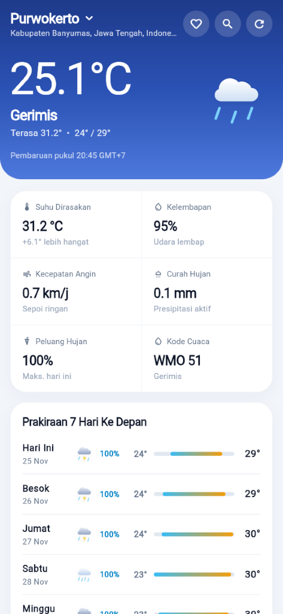
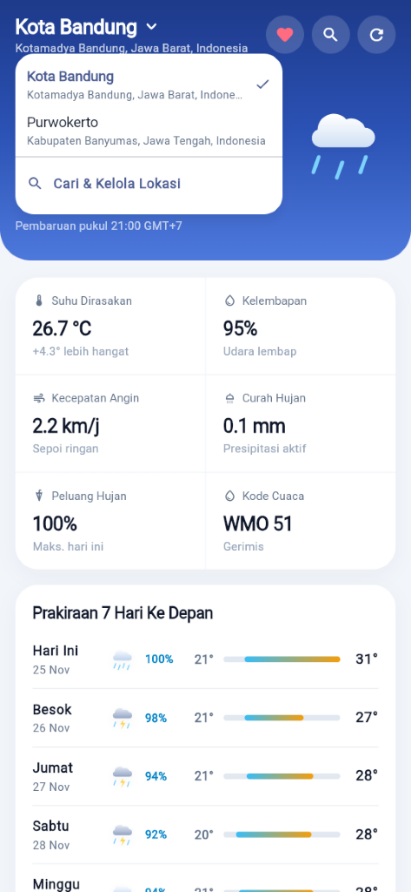
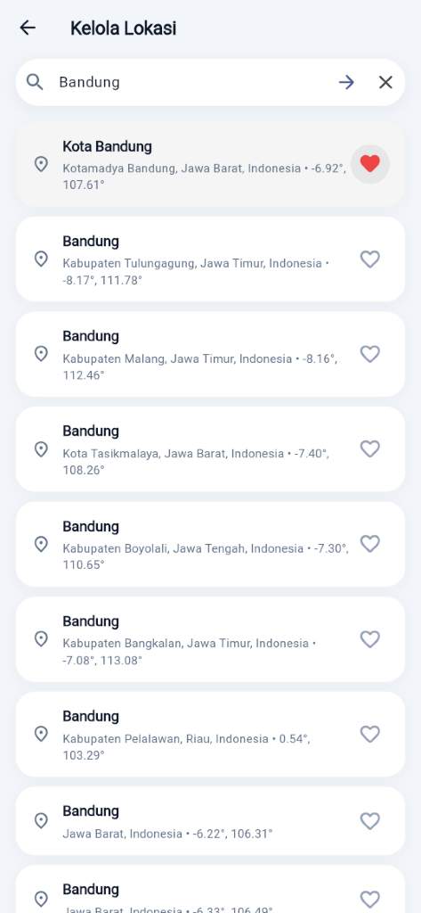

# CuacaKu — Aplikasi Prakiraan Cuaca Flutter (Open-Meteo)

Aplikasi prakiraan cuaca berbasis **Flutter & Dart** dengan standar desain **Material Design 3**, arsitektur **Model-View-ViewModel (MVVM)** menggunakan **Provider**, penyimpanan lokal **SharedPreferences**, dan integrasi **REST API Open-Meteo** (Weather Forecast & Geocoding API).

## Data Mahasiswa

- **Nama:** Fauzan Malik Arkan
- **NIM:** H1D024036

---

## Tangkapan Layar Aplikasi

| Home / Weather Screen | Dropdown Kota Favorit | Search / Location Screen |
|:---:|:---:|:---:|
|  |  |  |

---

## Fitur Utama

1. **Home / Weather Screen**
   - Menampilkan nama kota yang sedang dipilih beserta wilayah administratifnya.
   - Menampilkan kondisi cuaca terkini (deskripsi & ikon sesuai kode cuaca WMO).
   - Menampilkan suhu saat ini (`current.temperature_2m`).
   - Menampilkan metrik detail: suhu dirasakan (`current.apparent_temperature`), kelembapan udara (`current.relative_humidity_2m`), kecepatan angin (`current.wind_speed_10m`), curah hujan (`current.precipitation`), peluang hujan maksimum (`daily.precipitation_probability_max`), serta kode kondisi cuaca (`current.weather_code`).
   - Menampilkan prakiraan cuaca 7 hari ke depan (`daily.temperature_2m_min`, `daily.temperature_2m_max`, `daily.weather_code`, dan `daily.precipitation_probability_max`).
   - Mendukung *pull-to-refresh*, tombol muat ulang, serta pemilih kota favorit berbentuk *dropdown* saat nama kota pada header diketuk.
   - Menangani kondisi **loading**, **data kosong**, dan **error** lengkap dengan tombol *Coba Lagi*.

2. **Search / Location Screen**
   - Pencarian kota secara real-time (dengan debounce) maupun submit manual ke **Open-Meteo Geocoding API**.
   - Menampilkan daftar hasil pencarian kota beserta wilayah, negara, dan koordinat lintang/bujur.
   - Memilih kota dari hasil pencarian untuk langsung menampilkan cuaca terkininya di Home Screen.
   - Menyimpan dan menghapus lokasi sebagai **Favorit** maupun **Riwayat Pencarian** secara persisten di **Local Storage (`SharedPreferences`)** sehingga data tetap tersedia saat aplikasi dibuka kembali.

---

## Struktur Aplikasi (MVVM)

```text
lib/
├── main.dart                              # Entry point & konfigurasi MultiProvider
├── models/
│   ├── location_model.dart                # Model data kota (Geocoding & Local Storage JSON)
│   └── weather_model.dart                 # Model CurrentWeather, DailyForecast, WeatherData
├── services/
│   ├── weather_api_service.dart           # HTTP GET client untuk Open-Meteo Forecast & Geocoding
│   └── local_storage_service.dart         # Persistensi SharedPreferences (favorit, riwayat, kota aktif)
├── viewmodels/
│   ├── weather_viewmodel.dart             # State management cuaca terkini & daftar favorit (ChangeNotifier)
│   └── search_viewmodel.dart              # State management pencarian kota & riwayat (ChangeNotifier)
├── views/
│   ├── home_weather_screen.dart           # View utama kondisi cuaca & prakiraan 7 hari
│   ├── search_location_screen.dart        # View pencarian kota, favorit, & riwayat
│   └── widgets/
│       ├── daily_forecast_tile.dart       # Komponen baris prakiraan harian & rentang suhu
│       ├── state_feedback_view.dart       # Komponen tampilan empty & error state
│       ├── weather_illustration.dart      # Ilustrasi cuaca vektor kustom (CustomPainter)
│       └── weather_metric_card.dart       # Panel detail kondisi cuaca terpadu (WeatherDetailsPanel)
├── theme/
│   └── app_theme.dart                     # Material 3 ThemeData & Typography
└── utils/
    └── weather_helper.dart                # Pemetaan kode cuaca WMO & format tanggal Indonesia
screenshots/
├── 01_home_weather_screen.png
├── 02_search_location_screen.png
└── 03_home_favorit_bandung.png
test/
└── widget_test.dart                       # Unit test & widget test (model, API, storage, UI)
```

---

## Penerapan Arsitektur MVVM

1. **Model (`lib/models/`)**: Merepresentasikan struktur data `WeatherData`, `CurrentWeather`, `DailyForecast`, dan `LocationModel` beserta metode `fromJson` / `toJson` untuk konversi respons JSON dari API maupun penyimpanan lokal.
2. **Service (`lib/services/`)**:
   - `WeatherApiService` melakukan HTTP `GET` ke REST API Open-Meteo dan menangani error jaringan, timeout, status non-200, dan JSON kosong.
   - `LocalStorageService` mengelola baca/tulis JSON ke `SharedPreferences`.
3. **ViewModel (`lib/viewmodels/`)**: `WeatherViewModel` dan `SearchLocationViewModel` mewarisi `ChangeNotifier` (paket `provider`). ViewModel memisahkan logika bisnis dan pengelolaan state (`ViewState`: `initial`, `loading`, `loaded`, `empty`, `error`) dari UI lalu memanggil `notifyListeners()` saat state berubah.
4. **View (`lib/views/`)**: `HomeWeatherScreen` dan `SearchLocationScreen` mendengarkan perubahan state dari ViewModel melalui `Consumer` / `context.watch` tanpa menaruh logika HTTP atau parsing JSON di dalam widget.

---

## Implementasi REST API Open-Meteo

### 1. Weather Forecast API
Endpoint: `https://api.open-meteo.com/v1/forecast`

Parameter `GET`:
- `latitude`: koordinat lintang lokasi terpilih
- `longitude`: koordinat bujur lokasi terpilih
- `current`: `temperature_2m,relative_humidity_2m,apparent_temperature,precipitation,weather_code,wind_speed_10m`
- `daily`: `weather_code,temperature_2m_max,temperature_2m_min,precipitation_probability_max`
- `timezone`: `auto`

### 2. Geocoding API
Endpoint: `https://geocoding-api.open-meteo.com/v1/search`

Parameter `GET`:
- `name`: kata kunci nama kota dari input pengguna
- `count`: `10`
- `language`: `id`
- `format`: `json`

---

## Cara Menjalankan Aplikasi

### Melalui Android Studio

1. Buka folder proyek `responsi_flutter_cuaca` di **Android Studio** (*File -> Open*).
2. Tunggu proses *indexing*, sinkronisasi Gradle, dan `pub get` selesai (jika muncul banner *Get dependencies* di `pubspec.yaml`, klik **Pub get**).
3. Pastikan izin internet Android (`android/app/src/main/AndroidManifest.xml`) dan emulator atau perangkat sudah aktif (misalnya **Pixel 7** emulator, atau target **Chrome**).
4. Pilih perangkat tujuan pada toolbar atas Android Studio, lalu klik tombol **Run** (`Shift + F10`).

### Melalui Terminal

```bash
# 1. Unduh seluruh dependencies
flutter pub get

# 2. Jalankan analisis & pengujian otomatis
flutter analyze
flutter test

# 3. Jalankan aplikasi pada emulator Android / perangkat / Chrome
flutter run
```
